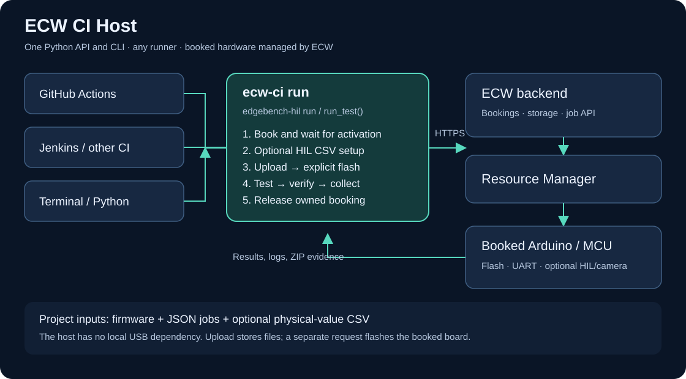

# ECW CI Host

Automate real hardware from a **terminal, Python application, Jenkins agent, or any CI runner** using one command:

**Discover → book or reuse a booking → wait for activation → optionally configure HIL → upload → explicitly flash → run jobs → verify evidence → release.**

`ECW_CI_Host` is the portable host-side client. ECW's backend and Resource Manager own the physical board, flashing tools, serial connection, and optional camera. The runner needs HTTPS access to ECW; it does not need a USB connection to the board.



Version **0.1.0** extracts the Python scripts from [ECW_CI_Github_Actions_Templates](https://github.com/DevHeadsCommunity/ECW_CI_Github_Actions_Templates) into a callable library, then adds a CLI and lifecycle orchestrator. The extraction is documented in [UPSTREAM.md](UPSTREAM.md). No CI-provider workflow files are required or included. `ecw-ci` and `edgebench-hil` are aliases for the same program. The core package uses Python's standard library and has no runtime dependencies. Start with the short user guide in [Markdown](docs/USER_GUIDE.md) or [Word](docs/ECW-CI-User-Guide.docx).

## Install and run the Arduino bench

The included bench targets **Arduino UNO R4 WiFi**, FQBN `arduino:renesas_uno:unor4wifi`. It turns on the built-in LED, then prints a numbered heartbeat once per second. A five-second ECW serial job must return at least four consecutive `ECW_CI_HOST_SAMPLE <n> LED=ON` records.

Use Python **3.11 or newer**. Clone the repository to get its example firmware, job files, and guides.

```sh
git clone https://github.com/DevHeadsCommunity/ECW_CI_Host.git
cd ECW_CI_Host
python3 -m venv .venv
. .venv/bin/activate
python -m pip install .

# Install Arduino CLI 1.3.1 on the machine doing the build, then:
bash examples/arduino/build.sh

# Read the key without displaying it or storing it in shell history.
read -r -s -p "ECW API key: " ECW_API_KEY
export ECW_API_KEY
# Set ECW_BACKEND_URL if your key belongs to a different ECW deployment.
ecw-ci validate --config examples/arduino/run.toml --check-firmware
ecw-ci run --config examples/arduino/run.toml
```

The build script installs the pinned `arduino:renesas_uno@1.6.0` core. Firmware compilation is project-owned and happens before calling the host. Official references: [Arduino CLI](https://github.com/arduino/arduino-cli/releases/tag/v1.3.1), [board core](https://github.com/arduino/ArduinoCore-renesas/releases/tag/1.6.0).

The heartbeat verifies that the expected firmware is running and reports the LED GPIO high. It does not measure physical light output. Camera capture is optional and requires the correct feed to be linked to the booked board. Hardware qualification of this repository is separate from its offline client checks.

## Trigger the bench from any runner

Once Python, this package, Arduino CLI, and `ECW_API_KEY` are available, a runner can execute:

```sh
bash examples/arduino/run.sh

# Forward CLI overrides, for example to reuse a specific booking:
bash examples/arduino/run.sh --booking-id 1234
```

`run.sh` builds the image, then invokes the portable CLI. It is a normal shell entry point: call it manually, on a schedule, or from your existing Jenkins, GitLab, GitHub, Buildkite, or other runner. Scheduling and artifact retention stay in the caller. Nothing here registers a runner or starts hardware tests on push.

## CLI command reference

```text
ecw-ci --help
ecw-ci run --help
ecw-ci validate --help
ecw-ci --version
python -m ecw_ci_host --help
```

| Command | Behavior |
| --- | --- |
| `ecw-ci validate --config project.toml` | Validate configuration, jobs, and optional CSV locally without a key or network. |
| `ecw-ci validate --config project.toml --check-firmware` | Also require the built, nonempty firmware file. |
| `ecw-ci run --config project.toml` | Execute the hardware lifecycle and save evidence. |
| `edgebench-hil run …` | Alias for the same CLI. |

| Option for `run` / `validate` | Purpose / default |
| --- | --- |
| `--config PATH` | TOML or JSON project file; otherwise supply board, firmware, and jobs directory. |
| `--board NAME` | Catalog name; exact match preferred, a unique partial match accepted. |
| `--firmware PATH` | Already-built `.bin` or `.hex`, up to 32 MiB. |
| `--jobs-dir PATH` | Directory containing ordered JSON jobs. |
| `--output-dir PATH` | Evidence parent directory; default `artifacts`. |
| `--backend-url URL` | HTTPS API base URL; default `https://plovdiv.edgebench.io/api`. |
| `--booking-id ID` | Use this owned booking and preserve it afterwards. |
| `--new-booking` | Skip discovery of existing reservations and request a new slot. |
| `--booking-timeout SECONDS` | Maximum activation wait; default 900. |
| `--job-timeout SECONDS` | Per-job polling limit; default 600, capped at job duration + 60. |
| `--poll-interval SECONDS` | Polling interval; default 2. |
| `--hil-sensor NAME`, `--hil-csv PATH` | Optional sensor and frontend-format CSV; set both together. |
| `--metadata-file PATH` | Additional non-secret JSON provenance object. |

Options override the configuration file. Example configurations can set different timeout defaults.

## Standalone CLI

```sh
edgebench-hil run \
  --board "Arduino UNO R4 WiFi" \
  --firmware build/arduino_ci_bench.ino.bin \
  --jobs-dir examples/arduino/jobs \
  --output-dir artifacts

# Preserve an explicit booking; its board type, status, and UTC window are verified.
ecw-ci run --config examples/arduino/run.toml --booking-id 1234

# Different ECW deployment and non-secret provenance:
ecw-ci run --config project.toml --backend-url https://lab.example/api \
  --metadata-file ci-provenance.json
```

`ECW_API_KEY` supplies authentication. `ECW_BACKEND_URL`, if set, overrides the configuration file; `--backend-url` takes precedence over both. Never put the key in a run configuration, job, or metadata file. The transport does not follow redirects with credentials and does not retry upload, flash, HIL writes, job creation, or release.

`run` prints one JSON result to stdout. Exit codes are `0` for a passed run, `1` for a workflow/verification/cleanup failure, `2` for invalid inputs or startup failure, and `130` for an interrupted run. `validate` makes no network requests; `--check-firmware` additionally checks the built file.

### Run configuration

TOML and JSON are supported. File paths in the configuration resolve from its directory; CLI path overrides resolve from the calling directory.

```toml
board = "Arduino UNO R4 WiFi"
firmware = "build/application.bin"
jobs_dir = "jobs"
output_dir = "artifacts"
backend_url = "https://plovdiv.edgebench.io/api"
booking_timeout = 900
job_timeout = 600
poll_interval = 2
minimum_remaining = 360

[metadata]
project = "my-firmware"
```

By default the host reuses the closest existing booking returned by `/bookings/me` for the selected board type. If none exists, it creates a booking. Reused and explicitly supplied bookings are preserved; only a booking created by this invocation is released. Use `--new-booking` or `reuse_existing = false` to request a fresh slot. Avoid running simultaneous callers against one reused booking.

Only `.bin` and `.hex` MCU firmware are supported in this first version. The host checks the selected board type through `/board` and `/board_type`, including when `/booking` returns a null `board_name`. It does not embed production database board IDs.

An active booking needs enough remaining time for the jobs, flash/preparation budget, and cleanup. If a CI-created catch-up slot is too short, the host requests **one extension of up to 30 minutes**, subject to backend conflicts, quotas, and maintenance rules. Reused or explicitly supplied bookings are never extended or cancelled. Expired and terminal bookings fail promptly. Operator maintenance must finish before a new session can activate.

## Python API

```python
from pathlib import Path
from ecw_ci_host import RunConfig, run_test

config = RunConfig(
    board="Arduino UNO R4 WiFi",
    firmware=Path("build/application.bin"),
    jobs_dir=Path("jobs"),
    output_dir=Path("artifacts"),
    metadata={"project": "my-firmware", "build": "local-42"},
)
result = run_test(config)  # reads ECW_API_KEY; api_key=... is also supported
print(result.to_dict())
raise SystemExit(result.exit_code)
```

`run_test()` validates all project inputs before booking. Invalid local inputs raise `ValueError`; operational failures return a failed `RunResult` after cleanup and evidence collection. A supplied `ECWClient` can be injected for integrations and offline tests.

### Jenkins and other CI systems

Prepare your agent with Python 3.11+ and the package, then bind `ECW_API_KEY` through its credential store. Run your build command followed by:

```sh
ecw-ci run --config project.toml
```

For the bundled Arduino example, run `bash examples/arduino/run.sh` instead. Preserve `artifacts/**` even when the command fails, and propagate the CLI exit code as the build result. Jenkins, GitLab, GitHub, and other callers all use these commands; the package reads no provider-specific variables. Pass build identity explicitly in `--metadata-file` when needed.

## Job files and verification

The host reads `*.json` files from `jobs_dir` in filename order and executes one backend job at a time. A numeric prefix such as `01_` sets the order. Each run generates a fresh idempotency key and evidence directory, so repeated runs do not reuse an old pass.

```json
{
  "name": "Five-second serial regression",
  "duration_seconds": 30,
  "commands": [
    {
      "id": "serial",
      "name": "Capture firmware output",
      "command": "mcu.serial_log",
      "attempts": 1,
      "timeout_ms": 5000,
      "parameters": {"filename": "application.log"}
    }
  ],
  "checks": [{"type": "text_contains", "file": "application.log", "text": "SELFTEST PASS"}]
}
```

`commands` use the existing public ECW job schema. `checks` are host-side assertions and are removed before submitting the job. Command timeouts multiplied by attempts must fit `duration_seconds`. Project job files cannot override the booking. Reserved provenance fields identify the host run, board, and firmware SHA256; the host verifies that job metadata is preserved by the API.

| Check | What it verifies |
| --- | --- |
| `text_contains` | A required string exists in a named artifact. |
| `serial_sequence` | A regex with a named `sample` group returns at least `minimum` consecutive integer samples. |
| `jpeg` | A named artifact has JPEG start/end markers; it does not classify optical content. |

A successful capture command alone is not a firmware behavior test. Add checks that express your expected result. The Arduino example uses `serial_sequence`. To add a camera capture, copy [examples/optional_camera/01_camera.json](examples/optional_camera/01_camera.json) into a project jobs directory after linking the camera in ECW.

## Optional HIL CSV playback

```sh
ecw-ci run --config project.toml \
  --hil-sensor BME280 --hil-csv examples/hil/bme280.csv
```

The host selects one sensor through the existing peripheral APIs, prepares it with a **180-second deadline**, then sends physical-value CSV data in batches of at most 128 words. The CSV encoder matches the frontend for BME280, ADXL345, MCP3565R, and Pmod MIC3, including channel order, scaling, signed words, and rounding. The exact sensor name must match the deployment's sensor list.

Invalid CSV fails before booking or selecting hardware. CSV values are sent only after preparation reports success; upload and explicit MCU flash follow HIL setup. Use matching sensor firmware and project checks to verify MCU readings. The included LED sketch does not read HIL sensor values.

## Results and cleanup

Each run writes `output_dir/<run-id>/`:

```text
summary.json                  Overall result, job IDs, errors, and exit code
reservation.json              Booking ID and whether this run created it
booking-response.json         Raw booking response
board-identity.json           Verified board instance and type
booking-extension.json        Present if this run extended its booking
firmware.json                 Local SHA256, stored filename, upload/flash outcome
hil.json                      Optional HIL preparation and CSV progress
release.json                  Present when a CI-created booking was released
jobs/<label>/
  request.json, created.json, job.json
  results.json, logs.json, artifacts.zip
  collection-errors.json, checks.json
```

Logs, results, and ZIP artifacts are collected on job failure too. A missing required bundle or incomplete metadata/results makes the run fail. ZIP members are bounded and read in memory for checks; server paths are never extracted onto the runner. Upload filenames contain a content hash to avoid collisions between concurrent builds.

Cleanup runs on normal exceptions and handled interrupts. It attempts to cancel queued jobs and releases only bookings created by this invocation. The current ECW cancel-job API supports **queued jobs only**: running jobs remain governed by backend execution/booking deadlines. A failed client using a supplied booking reports any still-running job and preserves the booking. Cleanup errors remain visible and make the run fail. Force-killing a process or runner can prevent cleanup; the backend's booking expiry remains the final limit.

## Existing API contract

| Operation | Public API |
| --- | --- |
| Discover board / find booking | `GET /board_types`, `GET /bookings/me` |
| Create/read booking | `POST /auto-bookings`, `GET /booking` |
| Resolve hardware identity | `GET /board`, `GET /board_type` |
| Extend/release owned CI booking | `POST /extend_booking`, `GET /cancel-booking` |
| Store firmware | `POST /upload` — files on NFS only |
| Confirm stored filename / explicitly flash | `GET` / `POST /v1/artifacts/my-uploads` |
| Select HIL | `GET /v1/peripherals-list`, `GET` / `PUT /v1/peripherals` |
| Prepare HIL and send CSV | `POST /v1/peripheral-prepare`, `POST /v1/peripheral-program-value` |
| Create/poll jobs | `POST /v1/ci/jobs`, `GET /v1/ci/jobs/{id}` |
| Collect evidence | `GET /v1/ci/jobs/{id}/results`, `/logs`, `/artifacts.zip` |
| Cancel queued job | `POST /v1/ci/jobs/{id}/cancel` |

No backend API additions are required. MPU/rootfs deployment, resumable two-stage activation callbacks, direct local USB control, and Twister-owned build/flash workflows are outside this first version.

## Source abstraction and offline checks

The template scripts are the starting implementation. Environment-bound `main()` functions became callable functions with arguments and return values. `GITHUB_OUTPUT`, `GITHUB_ENV`, and fixed `.github/user/` paths have been removed. The original template repository is unchanged.

| Extracted modules | Origin / responsibility |
| --- | --- |
| `ecw_client.py` | Template JSON, byte transfer, and multipart helpers; `client.py` is an object adapter. |
| `select_board.py`, `find_or_create_booking.py`, `wait_for_booking.py` | Template catalog lookup, reservation reuse/creation, UTC conversion, and activation polling. |
| `upload_firmware.py`, `flash_firmware.py` | Template storage upload, manifest verification, and separate explicit flash. |
| `configure_hil.py`, `hil_csv.py`, `hil_profiles/` | Template sensor selection, preparation deadline, word batching, and CSV encoding. |
| `create_jobs.py`, `poll_jobs.py`, `download_artifacts.py` | Template job-file ordering, submission, terminal polling, and artifact collection. |
| `booking.py`, `firmware.py`, `hil.py`, `jobs.py` | Portable adapters with identity checks, evidence, ownership, and assertions. |
| `runner.py`, `config.py`, `cli.py`, `evidence.py` | New orchestration, configuration, CLI, and per-run output. |

See [UPSTREAM.md](UPSTREAM.md) for the pinned source revision, hashes, and changes made during extraction. The MIT attribution is retained in [LICENSE](LICENSE).

```sh
python -m unittest discover -s tests -v
ecw-ci validate --config examples/arduino/run.toml
```

The checks use API stand-ins and contact no board. They cover failed upload/flash, HIL ordering/deadlines, reservation reuse/ownership, failed jobs, artifact verification, cleanup, and interrupts. Hardware runs require an eligible account, available board, and working ECW services; they are separate from these offline checks.

## Troubleshooting

| Symptom | Where to look |
| --- | --- |
| Missing key / HTTP 401 or 403 | Set `ECW_API_KEY` for the same deployment as `ECW_BACKEND_URL`; check account access. |
| Board lookup fails or is ambiguous | Use the full catalog name with `--board`. |
| Booking stays confirmed | Check the booking's UTC window, hardware availability, activation service, and maintenance. |
| Existing booking has insufficient time | Extend it yourself or request a fresh slot with `--new-booking`. |
| Upload or flash fails | Inspect `summary.json` and `firmware.json`; no job runs after a failed flash. |
| HIL preparation fails | Inspect `hil.json`; check sensor availability, CSV columns, and backend preparation support. |
| Capture completed but test failed | Inspect `jobs/<label>/checks.json` and the captured file in `artifacts.zip`. |
| Camera job fails | Ensure the booked board has the correct camera linked; the default bench requires no camera. |
| Release fails | Read `summary.json` and inspect the booking in ECW; reused bookings are intentionally retained. |

For more background, see the [short user guide](docs/USER_GUIDE.md) and the template's [API reference](https://github.com/DevHeadsCommunity/ECW_CI_Github_Actions_Templates/blob/main/docs/05-api-reference.md).
