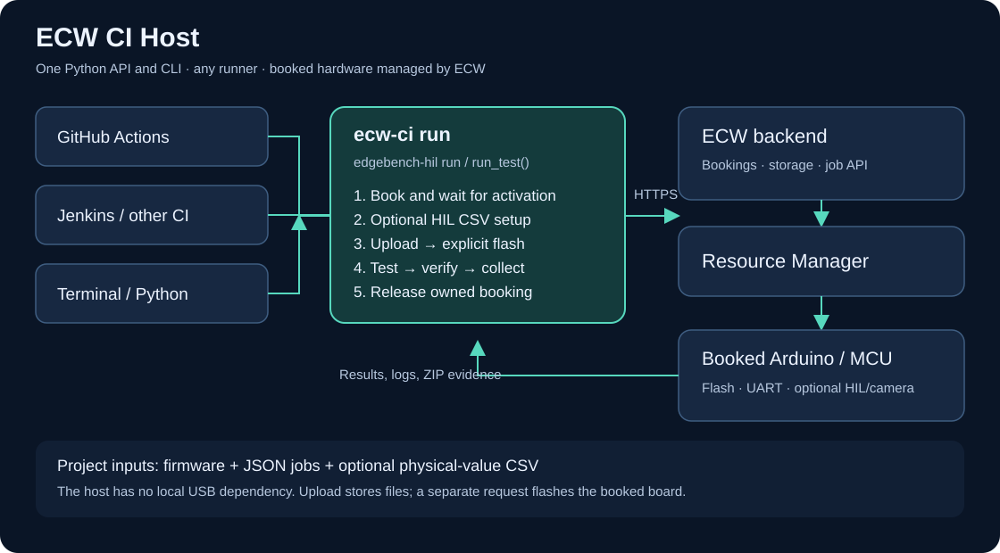

# ECW CI Host — short user guide

[Download the Word edition](ECW-CI-User-Guide.docx).

ECW CI Host automates a booked hardware session using one command. Use it from GitHub Actions, Jenkins, a terminal, or a Python application. Your CI runner builds the firmware and calls ECW over HTTPS. ECW operates the board and returns test evidence.

## From a lab board to a repeatable test

An ECW administrator registers the board and its programming/serial connections, sets availability, and links any camera or HIL equipment. A user with hardware access books that published board type. ECW prepares the session; the host then configures optional HIL, uploads firmware to NFS, explicitly flashes it, runs jobs, checks the results, and releases a booking it created.

| Use case | Example result |
| --- | --- |
| Firmware regression | The compiled Arduino image emits consecutive expected serial messages. |
| HIL stimulus playback | A sensor model receives the same physical-value CSV used by the frontend; project checks verify the MCU's response. |
| Visual evidence | An optional linked camera captures the board for review. |
| Developer reproduction | Run the same configuration locally after a CI failure. |

## First test: Arduino UNO R4 WiFi

1. Have Python 3.11+, Arduino CLI 1.3.1, an ECW API key, and access to an available `Arduino UNO R4 WiFi` board.
2. Install this package with `python -m pip install .` inside a virtual environment.
3. Run `bash examples/arduino/build.sh` to build the included sketch.
4. Provide `ECW_API_KEY` through your shell or CI secret manager.
5. Run `ecw-ci run --config examples/arduino/run.toml`.

The sketch turns the built-in LED on and prints one numbered heartbeat per second. The host uploads its BIN, makes a separate flash request, and captures five seconds of serial output. Passing requires at least four consecutive samples with `LED=ON`. This checks firmware execution and the reported GPIO state; it does not optically measure the LED.

## Trigger it from a runner

Use `bash examples/arduino/run.sh` from any prepared runner or terminal. It builds the sketch and invokes `ecw-ci run`. Your caller provides the API key, schedules execution, and retains `artifacts/**`, including on failure. No provider workflow is included.

Without `--booking-id`, the host reuses the closest existing booking for the board, or creates one if needed. Reused and supplied bookings are preserved. Only a booking created by this invocation is released. Use `--new-booking` for a fresh slot.

## Read the result

The CLI prints JSON and returns a nonzero exit code on failure. Open `artifacts/<run-id>/summary.json`, then the job's `checks.json`, `results.json`, `logs.json`, and `artifacts.zip`. Archive that directory using your runner or copy it from the local machine.

| Symptom | Check |
| --- | --- |
| API authentication/permission error | The ECW key, account eligibility, and endpoint. |
| Booking remains confirmed | Availability, operator maintenance, and the activation service. |
| Flash fails | `firmware.json` and the API error; jobs do not start after a failed flash. |
| Capture succeeded but the run failed | The firmware assertions in `checks.json`. |
| Camera missing | Link the correct feed before adding the optional camera job. |
| Cleanup failed | `summary.json` and the booking state; supplied bookings are preserved. |

The first version waits in the caller while a booking activates. It handles normal failures and interrupts, but a killed runner can prevent cleanup. Full configuration, API details, Python examples, and limits are in the [README](../README.md).
